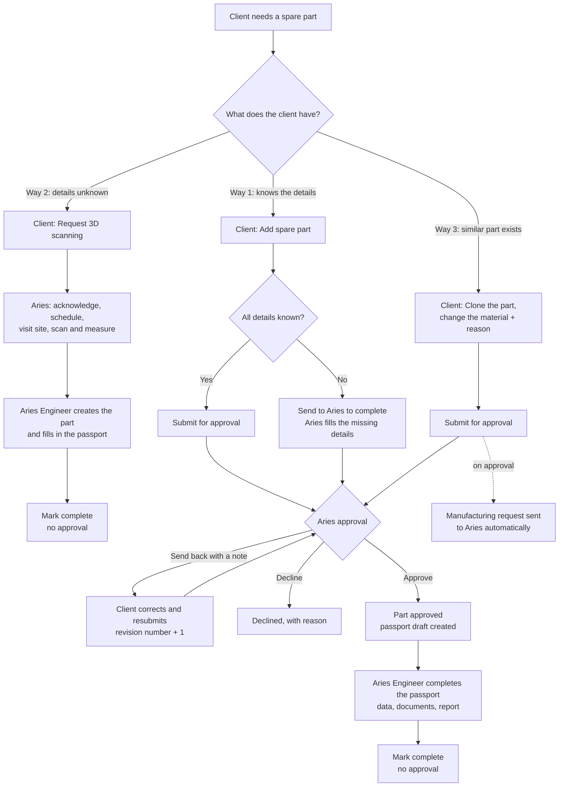
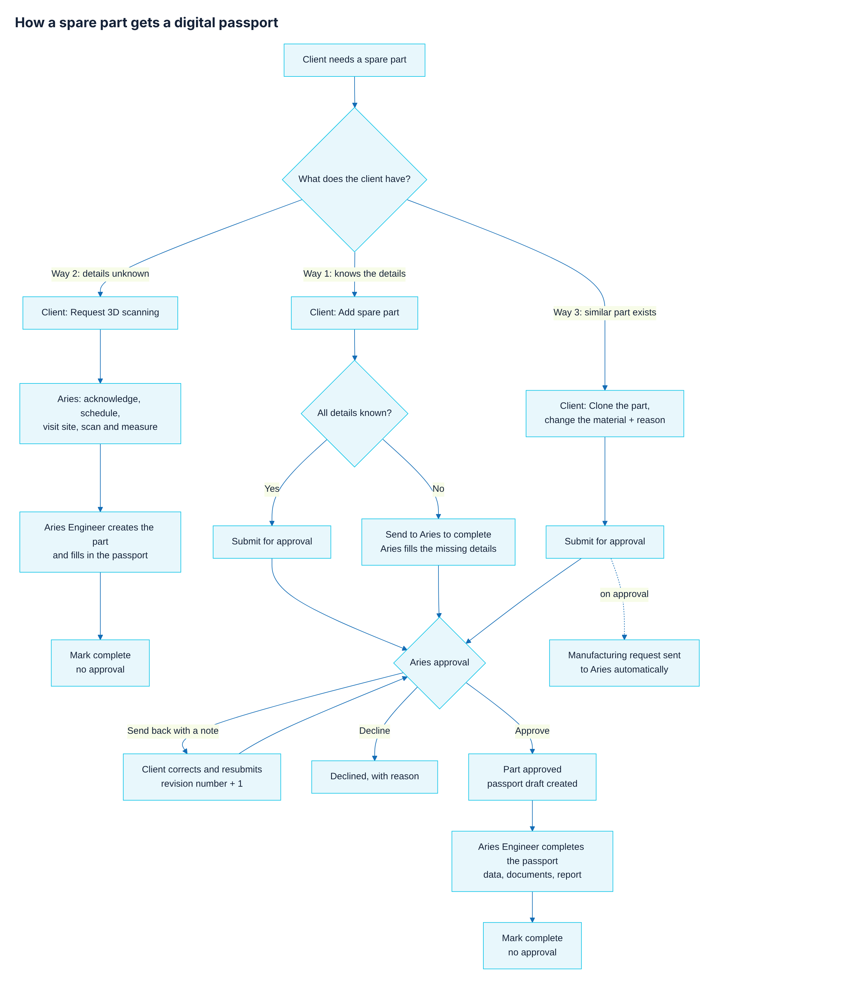

# How a spare part gets a digital passport

There are **three ways** a client gets a passport for a spare part. Ways 1 and 3 need approval by Aries; way 2 does not.
Anything an Aries member creates needs no approval.



## The three ways

| | Who enters the details | Approval | What happens at the end |
|---|---|---|---|
| **1. New part from the client** | The client enters what it knows. If everything is known: **Submit for approval**. If something is missing: **Send to Aries to complete** (Aries fills it in). | **Yes** | Approved → passport draft is created → Aries completes it and marks it **Complete** |
| **2. 3D scanning request** | Aries scans, measures and fills in everything | **No** (no Submit button) | Aries Engineer marks the passport **Complete** |
| **3. Clone with a new material** | The client clones an existing part and enters the new material and reason | **Yes** | Approved → passport draft is created **and the manufacturing request is sent to Aries automatically** |
| *Part created by Aries directly* | Aries | **No** | Aries Engineer marks the passport **Complete** |

## Approval (ways 1 and 3)

- **Who approves:** an **Aries Admin** or **Aries Manager** (sidebar → **Approvals**), or an **Aries Engineer** assigned
  to that client / project (on the spare-part page). The client never approves its own submission.
- **Who submits:** only the person who filled in the details can submit or resubmit them.
- **Approve** → the part is accepted, its passport draft is created (with the details the client gave), and for a clone
  the manufacturing request goes to Aries automatically.
- **Send back** → the approver writes what to change. The submission becomes **revision 2** (then 3, 4 …). The client
  corrects it and clicks **Resubmit for approval**.
- **Decline** → closed, with the reason shown to the client.

## Revision numbers when something is sent back

```
Revision 1  submitted  → sent back ("attach the drawing")
Revision 2  resubmitted → approved
```

## Passport status

| Status | Meaning |
|---|---|
| Draft | Aries is filling in the passport |
| **Complete** | An Aries Engineer marked it complete. The revision is locked; the report prints without the DRAFT watermark. A later change starts a new revision. |
| Published / manufacturing eligible | Not part of this flow yet (manufacturing release rules are still open, OQ-36) |

## Where to find things

| Role | Where |
|---|---|
| Client | **Digital inventory** → *Add spare part* or *Clone*; **My requests** → *Request 3D scanning*; sent-back items show *Resubmit for approval* |
| Aries Admin / Manager | **Approvals** (all client submissions), dashboard card *Client submissions awaiting approval* |
| Aries Engineer | Dashboard card *Client submissions waiting for approval*; spare-part page → *Approve / Send back / Decline*; passport page → *Mark complete* |



Client submissions must be switched on for the deployment: `CLIENT_PART_SUBMISSIONS_ENABLED=true` in the backend `.env`.
